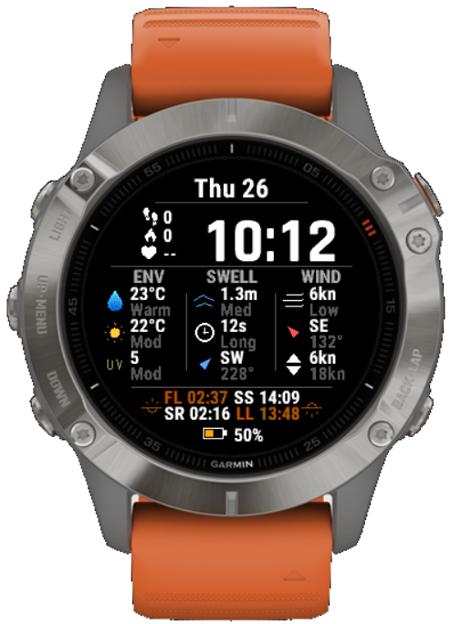

# SwellVision: a Garmin surf watch face

Live surf conditions on your wrist, wherever you're standing. Built by a surfer with
zero coding experience, using AI.

**Just want it on your watch?** It's free on the Garmin Connect IQ Store:
https://apps.garmin.com/en-US/apps/5859e191-2af1-4b10-b913-388b09a9985f

This repo is the full source, so you can pull it apart, change it, or use it as the
starting point for your own watch face.

## What it shows

- **Swell:** wave height, period, direction
- **Wind:** speed, direction, 6-hour min/max
- **Environment:** water temp, air temp, UV index
- **Light:** first light, sunrise, sunset, last light
- **You:** steps, calories, heart rate, battery
- **Tide (optional):** add your own free [WorldTides](https://www.worldtides.info) key in the watch face settings

Data comes from the free [Open-Meteo](https://open-meteo.com) Marine and Forecast APIs
(no key needed), using your watch's GPS, and refreshes every 30 minutes through your phone.

## Build it yourself

1. Install VS Code, the Garmin Connect IQ SDK, the Monkey C extension and Claude Code.
2. **Code → Download ZIP** above, unzip, then **File → Open Folder** in VS Code.
3. Command Palette (`Ctrl+Shift+P`) → **Monkey C: Generate a Developer Key**.
4. Press **F5** and pick your watch. The simulator shows demo surf data.
5. On a real watch: **Monkey C: Build for Device**, copy the `.prg` to `GARMIN\APPS` over a USB data cable.

Starting from scratch instead? Use the simpler starter:
https://github.com/aaronparton2-sketch/garmin-watchface-starter

## How it works

| File | What it does |
|---|---|
| `source/SurfDesignView.mc` | Draws the face: a layout worked out from the screen size, vector icons, the colour system |
| `source/SurfDesignDelegate.mc` | The background service: GPS → Open-Meteo marine → forecast → WorldTides (if a key is set) |
| `source/SurfDesignApp.mc` | Starts the app and schedules the 30-minute refresh |
| `manifest.xml` | Supported watches + permissions (Positioning, Background, Communications) |

⚠️ The biggest lesson from building it: background code needs the `(:background)`
annotation. The simulator works without it; the real watch silently shows "Waiting for
data" forever.

🔴 Never commit your `developer_key.der`. It's in `.gitignore`. Before publishing your own
version to the store, give it your own app id in `manifest.xml`.

Made by [Aaron Parton](https://www.youtube.com/@aaron-parton) · Mycelium AI · MIT licence
